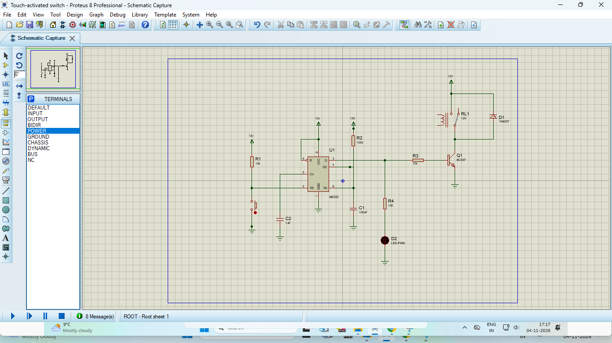
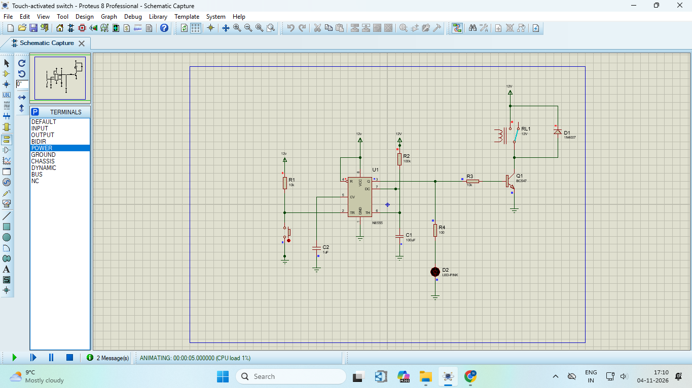
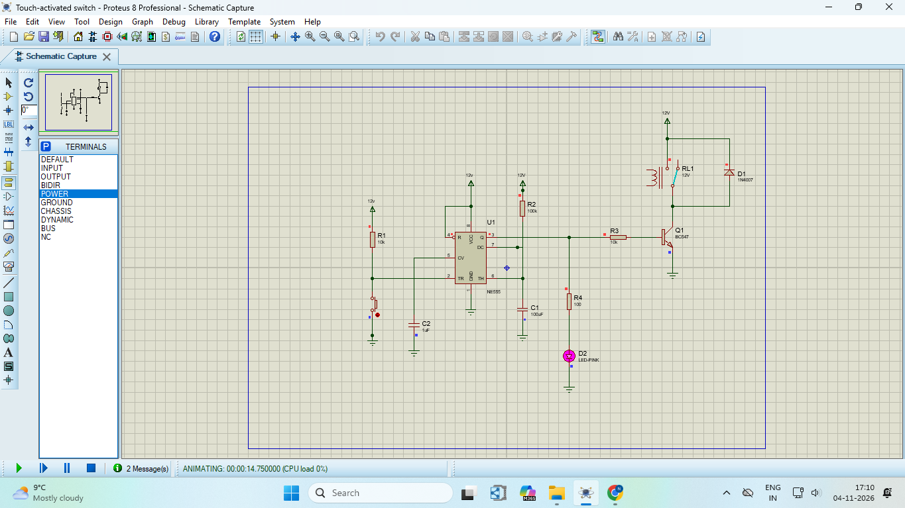

# Touch-Activated Switch using 555 Timer in Proteus


## Project Overview

This project is a touch-activated switch built with an **NE555 timer** and simulated in **Proteus 8**. It does not use any microcontroller, so no code and no programming software are needed. When the touch input is triggered, an LED and a 12 V relay turn ON for about 11 seconds and then turn OFF by themselves.

It is a simple way to learn how the 555 timer works in monostable mode and how a transistor drives a relay.

## Key Features

- Works without any microcontroller or code
- Single touch starts a timed output of about 11 seconds
- LED shows the output state
- Relay output can switch an external load through its COM and NO contacts
- Flyback diode protects the transistor
- ON time can be changed with R2 and C1

## Components Required

| Component | Value | Quantity |
|-----------|-------|----------|
| NE555 timer (U1) | - | 1 |
| Resistor (R1, R3) | 10k | 2 |
| Resistor (R2) | 100k | 1 |
| Resistor (R4) | 1k | 1 |
| Capacitor (C1) | 100uF | 1 |
| Capacitor (C2) | 1uF | 1 |
| NPN transistor (Q1) | BC547 | 1 |
| Diode (D1) | 1N4007 | 1 |
| LED (D2) | LED-PINK | 1 |
| Relay (RL1) | 12V | 1 |
| Push button (S1) | stands in for the touch plate | 1 |
| DC supply | 12V | 1 |

### Circuit Diagram

The circuit is drawn in Proteus 8. The push button S1 pulls the trigger pin of the 555 to GND, the same way a finger touch would.

[

### Pin Connections

| 555 Pin | Name | Connected To |
|---------|------|--------------|
| 1 | GND | GND |
| 2 | TRIG | R1 to +12V, and button S1 to GND |
| 3 | OUT | R3 to Q1 base, and R4 to LED D2 |
| 4 | RESET | +12V |
| 5 | CONTROL | C2 to GND |
| 6 | THRESHOLD | Joined to pin 7, then C1 to GND |
| 7 | DISCHARGE | Joined to pin 6, then R2 to +12V |
| 8 | VCC | +12V |

**Relay stage:** coil top to +12V, coil bottom to the collector of Q1, emitter of Q1 to GND, and D1 across the coil with its cathode (banded end) on the +12V side. The relay contacts COM and NO are left free for the load.

## Project Files

```
555-Touch-Activated-Switch-Proteus/
├── Touch-activated switch.pdsprj
├── Circuit_Diagram.png
├── LED_OFF.png
├── LED_ON.png
└── README.md
```

## Simulation Process

### Step 1: Open the Project

Open `Touch-activated switch.pdsprj` in Proteus 8.

### Step 2: Set the Power Rail

Rename all four +12V terminals to `VCC`. Then go to **Design → Configure Power Rails**, select **VCC/VDD** and set the voltage to **12**. This avoids the power rail error described in the Important Notes.

### Step 3: Press Play

Click the **Play** button at the bottom left. At the start the LED is OFF and the relay is in its resting position.

[

### Step 4: Touch the Button

Press and hold the push button **S1** with the mouse for about one second, then release it. This is the same as touching the plate.

### Step 5: Watch the Output

The LED turns ON and the relay switches. After about 11 seconds both turn OFF automatically.

[

## Output

| Condition | Pin 3 | LED D2 | Relay RL1 |
|-----------|-------|--------|-----------|
| Idle | LOW | OFF | OFF |
| Button pressed | HIGH | ON | ON |
| After about 11 seconds | LOW | OFF | OFF |

**Demo video:** [Watch the demo](YOUR_VIDEO_LINK)

## How It Works

1. R1 holds the trigger pin (pin 2) HIGH, so the output stays LOW and the LED and relay are OFF.
2. A touch (button press) pulls pin 2 to GND. The 555 triggers.
3. The output (pin 3) goes HIGH. The LED lights, and Q1 switches the relay ON.
4. C1 charges through R2. When it reaches two thirds of the supply voltage, the 555 ends the pulse.
5. The output goes LOW, so the LED and relay turn OFF.
6. D1 absorbs the voltage spike when the relay coil turns off.

```
Touch → 555 triggers → LED and relay ON → wait about 11 seconds → LED and relay OFF
```

**ON time:**

```
T = 1.1 × R2 × C1 = 1.1 × 100k × 100uF = about 11 seconds
```

## How to Run

1. Install **Proteus 8 Professional** on your computer.
2. Download or clone this repository.
3. Open `Touch-activated switch.pdsprj` in Proteus.
4. Make sure the power rail is set as described in Step 2.
5. Click **Play**.
6. Click and hold the button S1 for about one second, then release it.
7. Click **Stop** when you are done.

## Important Notes

### Power Rail Error

If Proteus shows `Power rails 'VCC/VDD' and '+12V' are interconnected`, the terminals are named +12V while the 555 uses the VCC rail. Rename all +12V terminals to `VCC` and set the VCC/VDD rail to 12 V in **Design → Configure Power Rails**.

### LED Resistor

R4 limits the LED current. With 1k the LED gets about 8 mA and glows clearly. Do not use a very small value such as 10 ohm, because the current would be far above the safe limit of the LED.

### Clicking the Button

Click on the push button itself and hold the mouse button down for a moment. The small red or blue dots in Proteus only show the pin levels and do nothing when clicked.

### Real Touch Plate

In a real build, replace the push button with a touch plate (a bare wire end or a copper pad) connected to pin 2. The simulation uses a push button because Proteus cannot simulate a finger.

## Technologies and Concepts

- NE555 timer
- Monostable multivibrator
- Transistor as a switch (BC547)
- Relay driving and flyback diode
- Proteus 8 circuit simulation

## Future Improvements

- Bistable version: one touch turns the output ON and the next touch turns it OFF
- Adjustable ON time using a potentiometer with R2
- Build the circuit on a breadboard with a real touch plate
- Connect a real load such as a bulb or a fan to the relay contacts
